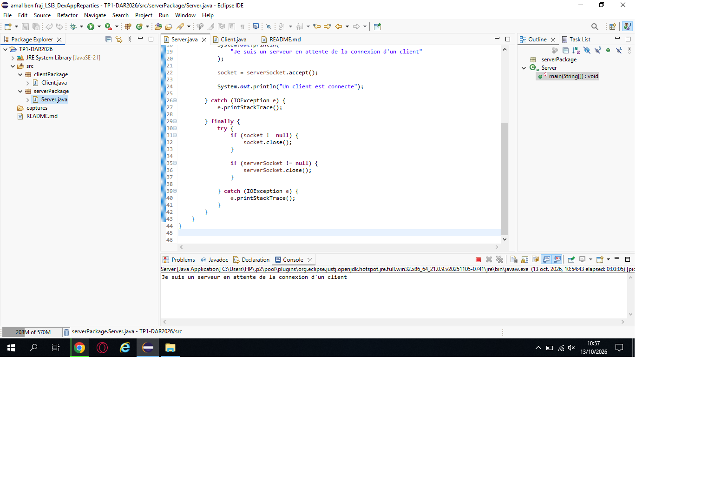
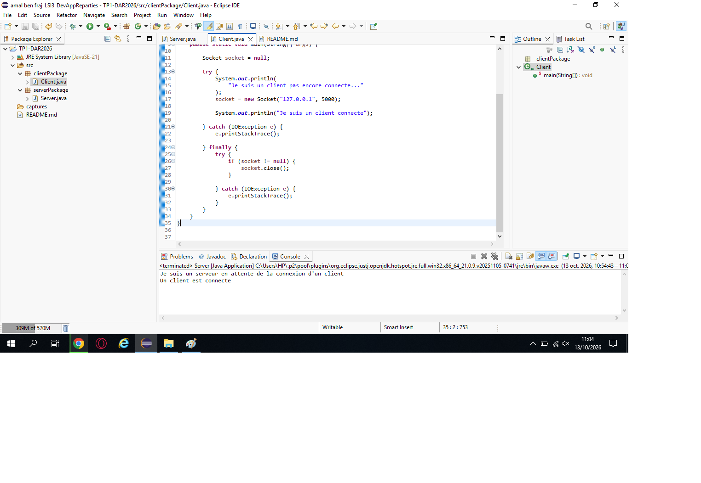
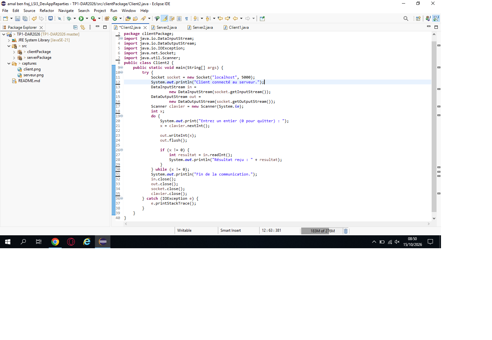
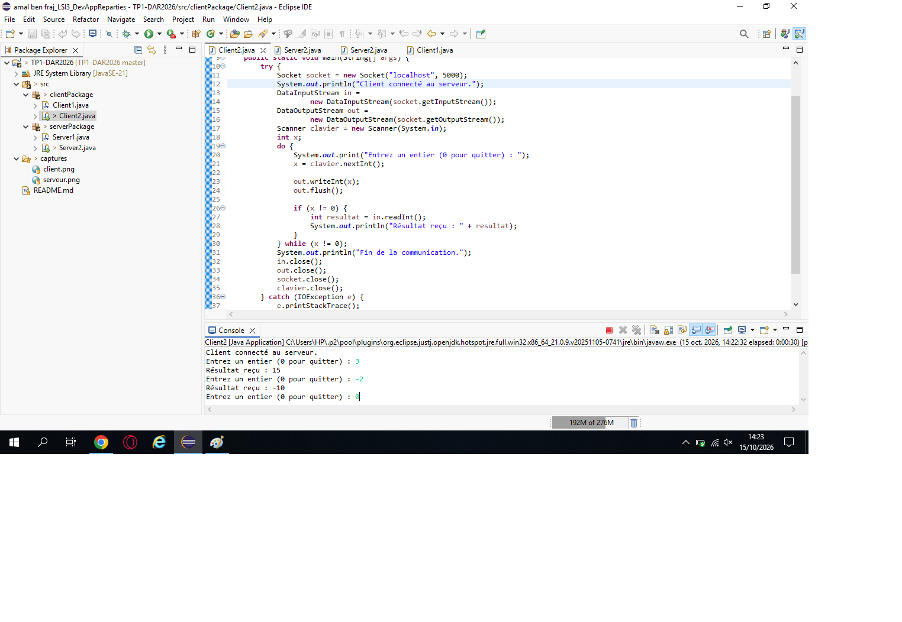
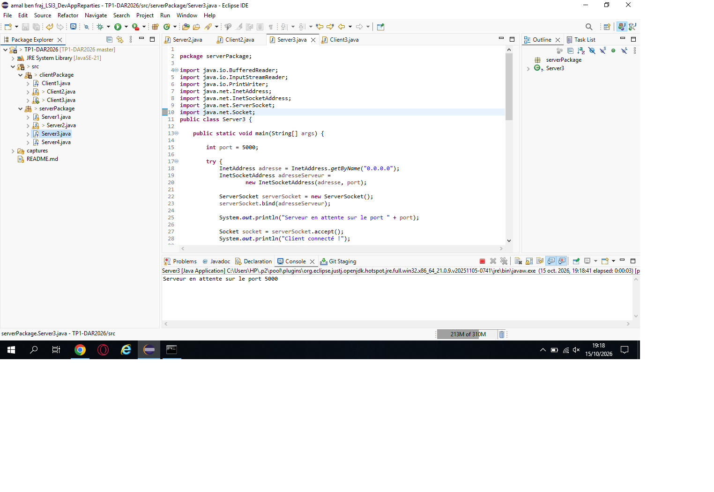
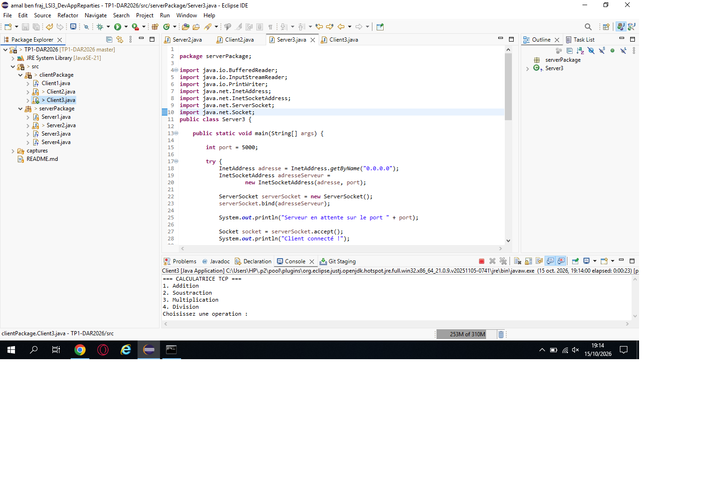
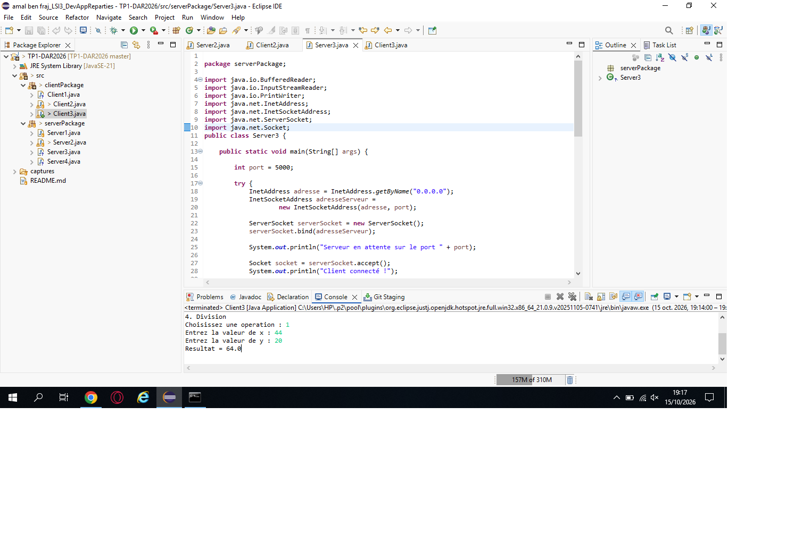

# TP1 - Les sockets TCP

## Informations générales

- Faculté : Faculté des Sciences de Sfax
- Année universitaire : 2026-2027
- Matière : Développement d'applications réparties

# Activité 1-1 : Première connexion Client/Serveur

## 1. Objectif

L'objectif de cette activité est de réaliser une connexion entre un client et un serveur en Java avec les sockets TCP.

## 2. Environnement

- Eclipse IDE
- Java JDK
- Git
- GitHub

## 3. Création du serveur

Le serveur utilise `ServerSocket` sur le port 5000 et attend la connexion d'un client.

## 4. Création du client

Le client utilise `Socket` pour se connecter au serveur sur le port 5000.

## 5. Résultats

Le serveur affiche un message lorsqu'il attend un client, puis confirme la connexion. Le client affiche un message avant et après sa connexion.

## 6. Test avec une adresse IP

Le client est testé avec l'adresse IP `127.0.0.1`.

## 7. Conclusion

Cette activité permet de comprendre l'établissement d'une connexion client/serveur avec les sockets TCP en Java.

## 8. Captures d'écran

### Console du serveur

### Console du client

---

# Activité 1-2 : Service de multiplication TCP

## 1. Objectif

Étendre l'application Client/Serveur TCP pour permettre au serveur de multiplier un entier envoyé par le client par 5.

## 2. Fonctionnement

1. Le client saisit un entier au clavier.
2. Le client envoie cet entier au serveur.
3. Le serveur reçoit l'entier et calcule le produit `x * 5`.
4. Le serveur envoie le résultat au client.
5. Le client reçoit et affiche le résultat.
6. La communication continue jusqu'à ce que le client saisisse `0`. Les sockets sont alors fermées proprement.

## 3. Tests effectués

- `x = 2` → résultat attendu : `10`
- `x = -3` → résultat attendu : `-15`
- `x = 4` → résultat attendu : `20`
- `x = 0` → arrêt de la communication

## 4. Captures d'écran

### Exécution du serveur

### Exécution du client

### Test de multiplication

## 5. Conclusion

Cette activité permet d'étendre une application Client/Serveur TCP en ajoutant un service de calcul côté serveur. Elle permet également de comprendre l'échange d'entiers positifs et négatifs avec `DataInputStream` et `DataOutputStream`, ainsi que la fermeture correcte des sockets.

## Activité 1-3 : Amélioration du service de calculatrice TCP

### Étape 1 : Communication entre deux machines
- Utilisation de `InetAddress` et `InetSocketAddress`.
- Serveur TCP sur le port 5000.
- Connexion du client à l'adresse IP du serveur.

### Étape 2 : Calculatrice améliorée
Le client propose quatre opérations :
1. Addition
2. Soustraction
3. Multiplication
4. Division

Le client transmet l'opération choisie et les deux valeurs au serveur.
Le serveur effectue le calcul et renvoie le résultat au client.

### Tests réalisés
- Addition : 10 + 5 = 15
- Soustraction : 10 - 5 = 5
- Multiplication : 10 * 5 = 50
- Division : 10 / 5 = 2
- Division par zéro : affichage d'un message d'erreur.

### Captures d'écran

#### 1. Exécution du serveur

#### 2. Exécution du client

#### 3. Test de calcul

